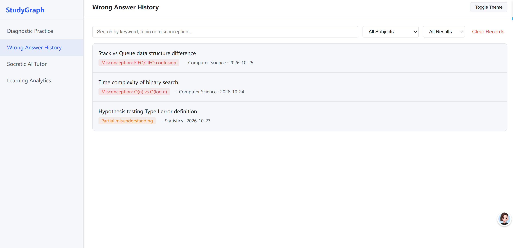
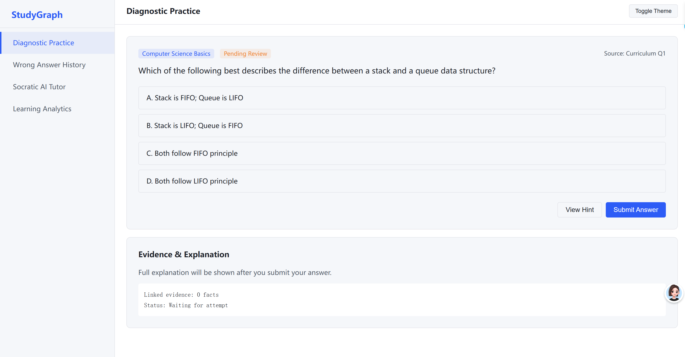

# Chapter 5.5 Implementation: Graphical User Interface

## 5.5.1 Design Philosophy of Cyber Obsidian Console System

### 5.5.1.1 Console-style interface positioning for STEM learning scenarios
The graphical user interface of StudyGraph adopts a "Cyber Obsidian" console-style design language, which is tailored for undergraduate STEM students and professional exam learners. Different from consumer-oriented learning products with rich decorative elements, the interface prioritises operational efficiency, information density and traceability of learning evidence, which matches the usage habits of target users who are familiar with developer tools and professional software (Sommerville, 2016).

The global layout follows a classic workspace split architecture. The interface consists of a fixed left sidebar for primary navigation, a top status bar for page context and global controls, and a main content area for business modules. This structure is implemented in `frontend/index.html` with Flexbox layout, ensuring stable visual weight and consistent switching experience across all functional pages.

### 5.5.1.2 Dual-theme colour variable system and implementation logic
To satisfy the accessibility requirement NFR-03 and adapt to different usage scenarios, the system supports both light and dark themes. The colour system is built on CSS custom properties defined globally in `frontend/style.css`, and switched by modifying the `data-theme` attribute on the root HTML element. This implementation allows theme switching to take effect globally without page reload, and reduces the maintenance cost of dual-theme styles (StudyGraph Group 5, 2026a).

The colour specification includes three levels of neutral colours for background, text and borders, a primary brand colour for interactive highlights, and four functional colours for status feedback. All colour combinations meet the WCAG AA contrast standard, which is a core part of the accessibility design framework.

### 5.5.1.3 8px grid system and unified typography specification
All spacing, padding and component dimensions follow the 8px grid principle, meaning all size values are multiples of 8px. This rule ensures visual consistency across the entire product, reduces arbitrary decision-making during front-end development, and improves the efficiency of design-development collaboration.

For typography, the system uses system sans-serif fonts for body content to ensure cross-platform readability, and monospaced fonts for data labels, evidence sources and code-related content to strengthen the console-style professional atmosphere. A four-level typography hierarchy is defined, from page titles to auxiliary captions, to ensure a clear information hierarchy.

## 5.5.2 Core Component Interaction Design

### 5.5.2.1 Global light and dark theme switching mechanism
The theme toggle button is placed in the top status bar, which is a globally visible entry. The switching logic is implemented in `frontend/app.js`: clicking the button modifies the `data-theme` attribute of the root element, and all style variables are replaced synchronously through the CSS cascade mechanism. The interaction follows the principle of immediate feedback: the visual style updates instantly after clicking, and no additional confirmation is required.

### 5.5.2.2 Collapsible hint and explanation accordion component
In the diagnostic practice page, hints and full explanations are hidden by default, and are displayed only when the user actively clicks the corresponding button. This design strictly aligns with requirement FR-09: viewing a hint does not count as an attempt, and the full explanation is only revealed after the user submits an answer and requests it (StudyGraph Group 5, 2026b).

The component uses an accordion-style expansion and collapse interaction, with a clear arrow indicator for the open/close state. The interaction logic is controlled by front-end JavaScript, which ensures that the answer content is not exposed in advance, protecting the fairness of the diagnostic process.

### 5.5.2.3 Split-Screen Trap Drawer architecture
The core diagnostic interaction is built on a five-layer Trap Drawer architecture, which uses a 60/40 split-screen layout instead of a traditional modal dialog.

*Figure 5.3: StudyGraph Question Arena and Five-Layer Trap Drawer upon selecting Distractor A. Source: Live browser capture of repository baseline.*

As shown in Figure 5.3, the left workspace retains the full question stem and options, while the right drawer progressively discloses structured misconception diagnostics across five layers:
1. Selected option and misconception badge
2. Cognitive mechanism description
3. Prerequisite concept anchor
4. Local knowledge subgraph
5. Remedies and Socratic follow-up prompts

This design is justified by cognitive load theory (Sweller, 1988): a centered modal dialog would obscure the four answer options and force working-memory reload, while the side-by-side layout enables direct visual comparison between the selected distractor and the correct standard. This structure aligns with requirement FR-08 by making all diagnostic evidence and source information fully traceable.

### 5.5.2.4 Five-axis competency radar integration
The competency analytics view is built on ECharts, which visualises user mastery across five dimensions: conceptual recall, prerequisite reasoning, misconception recognition, cross-topic reasoning and procedural accuracy. This component corresponds to functional requirement FR-04.

Clicking the Competency Analytics view transitions the workspace to the diagnostic dashboard, which combines two complementary visualisations: the five-dimension mastery radar and aggregate learning statistics cards. The dashboard implements graceful degradation: when no learning records exist, a zero-attempt empty state is displayed with guidance to start practice, instead of showing an invalid 0% score. This behaviour aligns with requirement NFR-07.

*Figure 5.5: Five-axis competency radar chart showing mastery dimensions and attempt-based evidence labels.*

Dimensions with fewer than two valid attempts are clearly labelled "Insufficient evidence" instead of showing an inaccurate percentage. Each dimension displays both the accuracy rate and the number of attempts, so that users can correctly understand the credibility of the data.

### 5.5.2.5 Sandbox comparison state component
The sandbox comparison component is used in the answer feedback scenario to visually present the state difference before and after answering, and to compare the user's reasoning path with the standard evidence basis. This component strengthens the traceability of the diagnostic process, allowing users to clearly perceive the basis for wrong-answer diagnosis.

## 5.5.3 Responsive Design and Accessibility Review

### 5.5.3.1 Desktop-first responsive adaptation rules
The interface follows a desktop-first design strategy, which aligns with the main usage scenario of students learning on desktop computers. At the same time, basic responsive adaptation is provided to ensure that core functions are available on tablet and mobile screens, meeting requirement NFR-08.

On narrow screens, the left sidebar is collapsed into a top menu, and the Trap Drawer switches from side-by-side split-screen to vertical stacked layout, ensuring that text is not obscured and main interactive controls are clickable.

### 5.5.3.2 WCAG-compliant accessibility design principles
All interface designs follow core accessibility principles to meet NFR-03. First, all status feedback uses a dual representation of icon plus text, rather than relying solely on colour to convey correct or wrong results. Second, all text and background colour combinations meet WCAG AA contrast standards to ensure readability for users with visual impairment. Third, all interactive controls have clear hover, active and disabled states to provide clear operational feedback.

### 5.5.3.3 UI restoration acceptance and review workflow
To ensure that the final front-end implementation is consistent with the design specification, a complete UI restoration acceptance mechanism is established. The acceptance checklist covers six dimensions: layout, colour, components, spacing, typography and interaction. Each item is checked one by one during the acceptance phase to ensure the quality of the final delivered interface.

## 5.5.4 Student Console Overview and Dashboard Integration

*Figure 5.4: Panoramic view of the student-side main console and analytics dashboard.*

The student console provides a unified workspace for diagnostic practice, competency analysis and review history. The left navigation maps functional modules to specific front-end views, while the main content area dynamically loads question items, feedback components and data visualisations without disrupting the user’s current task context.

The analytics dashboard view is reachable through the left sidebar and is supported by backend endpoints such as `GET /api/reports/summary` and `GET /api/reports/trend`. These endpoints provide the aggregated data required for the five-axis radar and summary cards, ensuring that the visual layer remains aligned with the backend data model.

---

## References
Sweller, J. (1988). Cognitive load during problem solving: Effects on learning. *Cognitive Science*, 12(2), 257-285.
Sommerville, I. (2016). *Software Engineering* (10th ed.). Pearson Education.
StudyGraph Group 5. (2026a). UI Design System Specification [Repository file]. `reports/ui-design/02-design-system.md`
StudyGraph Group 5. (2026b). Requirements Traceability Matrix [Repository file]. `reports/add-use-cases-and-rtm-227/rtm.md`
University of Aberdeen. (2026). JC2001 Introduction to Software Engineering Course Brief.
