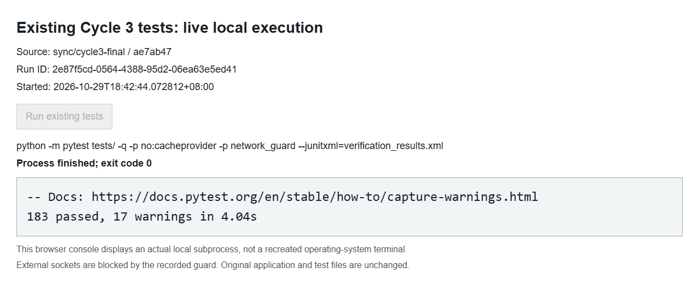

# Appendix C Test Inventory and Acceptance Evidence

Primary snapshot: ae7ab47. [Complete 183-case CSV](evidence/cycle3/test_case_inventory.csv), [primary JUnit](evidence/cycle3/pytest_results.xml) and [original transcript](evidence/cycle3/pytest_output.txt). The CSV and exact-wording crosswalk are also embedded in the PDF.

The screenshot shows a separate real subprocess run in a local browser console, not a simulated OS terminal. Its run ID, raw transcript and JUnit are in evidence/cycle3/verification_*. The primary run remains 183 passed, 17 warnings in 1.83s; the independent rerun was 183 passed, 17 warnings in 4.04s. Runs are not added together.

Tables C.1 and C.2 in the PDF evaluate all ten assigned NFRs and all ten later-draft quality requirements separately. Exact assigned functional wording and later-draft differences are preserved in requirement_crosswalk.md.
