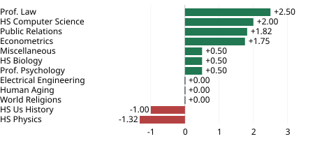

# 6 Testing and Evaluation

## 6.1 Testing Strategy

### 6.1.1 Scope and reproducible baseline

The primary subject is the existing `sync/cycle3-final` commit `ae7ab47`, retrieved on 29 October 2026. We also checked master commit `10f2065`. These versions contain different application capabilities. Master has four API operations and 12 seed questions. The Cycle 3 version has nine operations and 17 seed questions across nine subject codes. Results are therefore attributed to a specific snapshot; full revision identifiers are recorded in the evidence package.

Verification asks whether an implementation follows a specification; validation asks whether it addresses its intended purpose (Sommerville, 2016). We used existing pytest tests for regression verification, supplementary requests for requirement checks, and browser interactions for the user workflow. The supplementary checks are separate evidence and are not added to the repository test count. No application or original test file was changed to obtain a passing result.

Reproduction should use the recorded dependency versions and the same source revision. Durations or warnings may vary even if outcomes match. The evidence records this execution, not a promise that every computer reproduces an identical time. Missing external credentials were intentional; the audit did not consume live model services or test third-party availability. The full case inventory records names rather than inferred coverage percentages.

### 6.1.2 Layers and counting rules

Figure 6.1 shows four complementary layers. Model and seed assertions check data structure. Interface tests check API responses. Integration checks cover static mounting and naming compatibility. Adversarial checks examine hostile inputs, simulated failures and concurrent requests. The layers overlap; a test can exercise several components. We do not assign arbitrary exclusive counts to the pyramid.

**Table 6.1 Existing test inventory**

| Module stem | Funcs | Cases | Coverage target |
| --- | --- | --- | --- |
| adversarial_backend | 25 | 38 | R02 R03; NFR-R2 |
| auth | 10 | 10 | R06 |
| cors | 4 | 19 | Interface integration |
| diagnose | 8 | 10 | R02 R03 |
| e2e_frontend | 6 | 6 | R09 static resources |
| empirical_stress | 7 | 12 | R01 R02 R03 |
| health | 5 | 8 | R09 health probe |
| llm_health | 19 | 36 | Optional LLM probe |
| quiz | 6 | 21 | R01 |
| reports | 9 | 23 | R04 R05 |

Source: audit and JUnit; stems omit test_ and .py.

The Cycle 3 run collected 183 cases from 99 test functions in ten files. Parameterisation creates multiple collected cases from one function: 183 is the sum of each function's collected instances, not 99 multiplied by a common factor. Loops inside one function remain one collected case. The existing exhaustive option loop therefore does not add a separate pytest case for every option.

The captured summary was 183 passed, 17 warnings in 1.83 seconds; process wall time was 2.643 seconds. The task pack's 78 functions and 145 cases describe an older target, not this snapshot. Master separately produced 150 passed. Exact package versions, hashes, JUnit results and the case inventory accompany Appendix C. External socket connections were blocked during pytest, while loopback remained available for the test framework. Live model responses were mocked. This establishes an offline API regression baseline, not complete browser independence from external resources (Myers, Sandler and Badgett, 2011).

## 6.2 Adversarial and Robustness Testing

### 6.2.1 Existing hostile input coverage

The existing `test_adversarial_backend.py` contains 25 test functions that expand to 38 collected cases. Table 6.2 groups their relevant behaviours into six review categories. All 38 passed. SQL-like strings, script fragments and traversal strings are test inputs already present in this file. They are not evidence of a discovered exploit. We found no verified defect history establishing how many original tests previously caught bugs, so we report no historical bug count.

**Table 6.2 Six robustness review groups**

| Group | Existing input or workload | Observed contract |
| --- | --- | --- |
| A1 | Unknown question ID | 200 fallback, not strict 404 |
| A2 | Z / blank; malformed JSON | 200 options; bad JSON rejected |
| A3 | SQL/script/traversal; long text | No-crash assertions passed |
| A4 | List ID or object option | 422 type validation |
| A5 | 50 diagnose / 50 quiz / 60 mixed | Bounded workload passed |
| A6 | Empty object / unknown subject | Fallback; empty report |

Source: existing tests and request probes; groups overlap.

Existing concurrency checks issue 50 diagnosis, 50 quiz and 60 mixed requests using thread pools and TestClient. Passing supports these bounded workloads, not production capacity or tenant isolation. Their elapsed-time limits do not measure API P95 distributions. Supplementary timings appear in Section 6.5. Warnings remain recorded and require separate review.

These categories target different failure mechanisms. Unknown identifiers test lookup boundaries; malformed and type-confused inputs test validation; injection-like strings challenge assumptions about untrusted text. Concurrent requests test the stability of the existing request path under a bounded workload. An empty response state tests whether absence is represented deliberately. Combining the categories into one success rate would hide which contract was actually exercised.

### 6.2.2 Robustness and contract correctness

Avoiding a server error is a weaker condition than satisfying the required error contract. Direct requests confirmed that an unknown question, an invalid option and an empty diagnosis object can return HTTP 200 with fallback content. Type-confused values returned 422. Consequently, the draft requirement for strict 404 and 422 responses is only partly met. Several original assertions intentionally accept fallback success; their passing status cannot overturn this mismatch.

The tests named `test_e2e_frontend.py` mainly request static resources and inspect text. They do not execute a real browser or prove that every control works. We therefore exercised the existing interface separately. With the expected ECharts resource available, four original disciplines displayed four options each, selecting an econometrics distractor returned HTTP 200, and the diagnostic drawer appeared. Language and theme controls also changed state.

A fresh browser with all external requests blocked raised `echarts is not defined` and rendered no option cards. The failure interrupts initialisation before the normal workflow is ready. A separate functional run supplied the exact ECharts 5.5.1 asset at its original CDN URL through the browser harness. This was a recorded test fixture, not an asset shipped by the repository. No external model request was sent. The two runs demonstrate why API-level offline success must not be presented as full offline application acceptance.

Fallback cases satisfy the existing assertions, so we have not relabelled them as failed tests. The requirement mismatch is recorded separately. Representative response bodies are retained for review. A rejected payload and an accepted fallback are different outcomes, even when both avoid exceptions.

This distinction also determines corrective work. The responsible developer first needs to agree whether a fallback is intended for each invalid input. The corresponding acceptance criterion and assertion can then be aligned. Changing only the report would leave the ambiguity unresolved, while tightening an assertion without an agreed contract would measure a different requirement. Existing regression outcomes remain useful during that decision.

## 6.3 Empirical Evaluation on MMLU

### 6.3.1 Recorded results and aggregation

MMLU evaluates multiple-choice knowledge across diverse subjects (Hendrycks et al., 2021). We inspected the repository's existing `final_systematic_report.csv`; we did not rerun paid model calls or create new experimental observations. Table 6.3 reproduces all twelve subject summaries. Baseline and Ours are proportions, while the difference is expressed in percentage points: 100 multiplied by Ours minus Baseline.

**Table 6.3 Stored MMLU subject results**

| Subject | Baseline | Ours | Change pp |
| --- | --- | --- | --- |
| Professional Law | 0.6100 | 0.6350 | +2.50 |
| HS Computer Science | 0.8600 | 0.8800 | +2.00 |
| Public Relations | 0.7273 | 0.7455 | +1.82 |
| Econometrics | 0.6491 | 0.6667 | +1.75 |
| Miscellaneous | 0.8850 | 0.8900 | +0.50 |
| HS Biology | 0.9200 | 0.9250 | +0.50 |
| Professional Psychology | 0.7750 | 0.7800 | +0.50 |
| Electrical Engineering | 0.7931 | 0.7931 | +0.00 |
| Human Aging | 0.7250 | 0.7250 | +0.00 |
| World Religions | 0.8538 | 0.8538 | +0.00 |
| HS Us History | 0.8850 | 0.8750 | -1.00 |
| HS Physics | 0.6026 | 0.5894 | -1.32 |

Source: existing final_systematic_report.csv; no new run.

Seven subjects improve, three tie and two decline. The unweighted mean subject difference is +0.6040 percentage points, rounded to +0.60. This is a macro average across the twelve rows. A pooled accuracy or weighted improvement cannot be recovered from this summary alone because it does not record the number of evaluated observations per row. Econometrics rounds to +1.75 percentage points from the stored precision, rather than the +1.76 stated in the task example.

### 6.3.2 Interpretation and experimental limits

Professional Law improves most, by 2.50 percentage points. Explicit legal conditions may help distinguish related rules. Physics declines by approximately 1.32 points: retrieved concepts may distract from numerical reasoning. US History declines by 1.00 point. These explanations are hypotheses; the CSV contains no retrieval traces or ablations establishing their causes.

The stored engine compares `glm-4-plus` with and without graph context; supporting `glm-4-flash` calls extract keywords and filter retrieved material. It caps prepared input at 200 rows per source file. This does not establish the historical configuration or support the draft's claim that 4,445 questions were evaluated.

The proposed explanation for law is that explicit conditions may help the model choose between similar rules. For physics, useful context must still support the calculation, units and reasoning steps; unrelated facts could consume attention without helping solve the item. These are testable interpretations of the stored differences. They are not observations of the model's internal reasoning, and the report does not present them as proven mechanisms.

To distinguish these explanations, a future comparison should preserve the same question, answer options, model version and prompt across both conditions, changing only the added graph context. Saved retrieval traces would show whether relevant rules were supplied; paired answer records would show which items changed. Repeating that controlled comparison would make variation measurable. These records are currently missing. Decimal patterns in the aggregate accuracy values cannot establish unique sample sizes, because several different counts can produce the same rounded proportion.

The file lacks paired outcomes, exact run identifiers and repeated samples. A paired significance test and independent reconstruction are therefore unavailable. We claim no statistical significance for changes near one percentage point. Negative results remain visible rather than being concealed by the average.

A difference in percentage points is also different from a relative percentage improvement. The law result subtracts 0.6100 from 0.6350 and multiplies by 100; it does not divide that difference by the baseline. The table and chart use the same calculation from full stored precision. Rounding each displayed accuracy before subtraction would create small discrepancies, including the econometrics example in the task pack.

The macro average weights each subject equally. It therefore answers whether the average subject row improves, rather than how many additional questions the system answers correctly overall. Without denominators, weighting the rows by assumed dataset sizes would invent information. Without matched item outcomes, even equal aggregate accuracies could conceal different individual successes and failures. The available summary supports a descriptive comparison, with these restrictions.

The stored results show subject-dependent differences with a small positive macro average. They do not establish improved learner achievement or deployment of the same graph pipeline in the browser. Online generation, offline benchmarking and curated diagnosis are distinct paths. Chapter 7 should preserve these boundaries. Consequently, this chapter reports stored evidence and its limits rather than reconstructing an undocumented experiment.

## 6.4 RAGAS Evaluation Status

### 6.4.1 Inspecting the available evaluator

RAGAS evaluates retrieval-augmented generation beyond final accuracy (Es et al., 2024). The task requests four metrics. However, the existing `ragas_evaluator.py` sends questions to three model configurations and compares extracted answer letters with references. It contains no RAGAS metric invocation or output for the requested measures.

**Table 6.4 Requested RAGAS metrics and available evidence**

| Metric | What it would evaluate | Verified score |
| --- | --- | --- |
| Faithfulness | Answer support in retrieved context | Not computed |
| Answer relevancy | Answer relevance to the question | Not computed |
| Context precision | Relevance of retrieved material | Not computed |
| Context recall | Coverage of reference information | Not computed |

Source: existing ragas_evaluator.py; no RAGAS output.

### 6.4.2 What can be concluded

No verified scores for these metrics were located in the supplied evaluation artefacts. The required mathematics input and comparison output referenced by that script are also absent from the inspected GraphRAG directory. This is an evidence gap, not a score of zero. We have no evidence that an embedding quota caused it and do not assign that explanation.

Answer accuracy cannot stand in for the missing metrics. A model may select the correct letter from prior knowledge while retrieving irrelevant material, or use relevant context but produce the wrong answer. Faithfulness and retrieval quality therefore require the actual contexts and answers, not just a final letter. The four measures in Table 6.4 describe an evaluation design; they are not measurements obtained in this project.

Different model names prevent a controlled retrieval ablation. Future evaluation requires saved questions, references, retrieved contexts, generated answers and metric configuration. These are proposed steps, not completed experiments. A filename cannot substantiate a methodological claim. No saved contexts were available to audit individual metric judgements retrospectively.

For such a future evaluation, one shared record per question should link its reference answer, retrieved passages and generated response. Faithfulness asks whether response claims are supported by those passages; answer relevancy asks whether the response addresses the question. Context precision concerns useful retrieved content, while recall concerns missing reference information. The evaluator version, judge model and configuration would also need recording. These requirements explain why the existing answer-letter summary cannot be converted into four scores after the event, even when its accuracy value is known.

## 6.5 Evaluation against the Requirements

### 6.5.1 Functional requirements and conflicting baselines

Table 6.5 follows the fourteen identifiers and priorities explicitly assigned in task pack 02, the baseline named by this contributor's task pack 07. Original Chinese labels quote that baseline verbatim; requirement_crosswalk.md supplies English translations and the full later-draft assessment. R10 therefore means GraphRAG enhancement and remains partial. The later Chapter 2 draft uses different definitions for several identifiers; its separate assessment is preserved in the same crosswalk rather than silently replacing the assigned requirements.

**Table 6.5 Functional requirements achievement**

| ID | Prio | Assigned requirement (verbatim) | Result | Ref |
| --- | --- | --- | --- | --- |
| R01 | Must | 学生可按学科浏览题目 | Met | T01 |
| R02 | Must | 学生可提交作答 | Met | T02 |
| R03 | Must | 系统提供选项级诊断（非题目级） | Partial | T03 |
| R04 | Must | 五维能力雷达与趋势 | Partial | T04 |
| R05 | Must | 学情摘要卡 | Partial | T05 |
| R06 | Must | 登录与注册 | Partial | T06 |
| R07 | Should | 中英双语界面 | Met | T07 |
| R08 | Should | 明/暗双主题 | Partial | T08 |
| R09 | Must | 离线零构建运行 | Unmet | T09 |
| R10 | Should | GraphRAG 图谱增强 | Partial | T10 |
| R11 | Won't | 多用户/多租户隔离 | Excluded | T11 |
| R12 | Won't | 移动原生 App | Excluded | T12 |
| R13 | Won't | 社交功能（排行榜/分享） | Excluded | T13 |
| R14 | Won't | 自动组卷 / 自适应出题 | Excluded | T14 |

Source: task pack 02, Table 2.2, verbatim labels. T keys: evidence ledger.

A partial result means that a visible feature exists but its acceptance criterion is not fully demonstrated. Subject filtering works with `subject=law`, meeting the original browsing criterion; the later draft's `category=law` returns all 17 questions. Existing diagnosis fields also differ from the required four-field schema. These are specification and implementation differences, not missing evidence to be filled with invented passes.

More substantial gaps affect state. A diagnosis request left summary counts unchanged at 18 attempts and 14 correct answers. The report service supplies constants despite a `session_telemetry` tag. Repeated registration returned 200 twice, the supplied password was not checked, and verification, logout and reset operations were absent. The existing authentication tests exercise demonstrator identity behaviour. They do not establish secure account management.

R11 to R14 retain the assigned exclusions: tenants, native apps, social features and adaptive exam assembly. Exclusion is a scope decision, not proof of security or a completed feature. The crosswalk also records the later draft's cloud-generation and crowdsourcing definitions. Aligning those definitions during integration is a report-owner decision, separate from recording the test evidence.

Evidence keys T01 to T14 identify the assigned baseline; F01 to F14 refer specifically to the later draft. These categories distinguish demonstrated behaviour, incomplete acceptance, missing evidence and intentionally excluded scope throughout the table.

### 6.5.2 Quality requirements and measurement boundaries

Appendix C, Table C.1 evaluates every original NFR across the five quality categories, with a threshold, outcome and evidence reference. The crosswalk additionally assesses all ten later quality identifiers. Usability remains partial: a tester walkthrough cannot establish unaided novice success, and switching themes cannot establish contrast compliance. Reliability fails fresh offline browser startup and only partly meets the error contract. Security review found exposed configuration. Maintainability has visible layering; its regression-count and runtime criterion is met.

For the original P95 threshold, we measured every implemented API operation over loopback HTTP: five warm-ups followed by 100 sequential observations per operation. The recorded P95 values ranged from 0.932 to 1.433 milliseconds. These observations include HTTP overhead and must not be relabelled as in-process timings. They support local performance with no model key; they do not establish cloud-mode latency. First contentful paint was 392 milliseconds in the browser fixture, exceeding the original 100-millisecond target. One observation is insufficient to characterise variability.

Credential scanning identified a hardcoded frontend key configuration and credential assignments in the research material. Values are excluded from the report and submission evidence. The quality owner should coordinate removal and rotation with the responsible maintainer. A passing injection test is not a substitute for this review. Likewise, switching themes does not prove WCAG AA contrast across every state (W3C, 2023).

## 6.6 Threats to Validity

### 6.6.1 Internal and external validity

First, the application and assertions share team assumptions. Independent probes and browser checks reduce this bias but cannot remove it. Passing test counts do not imply line coverage; no coverage report was collected.

Second, versions differ. Task packs, master, Cycle 3 and the packaged software are not interchangeable. Master passing does not establish its missing authentication or report routes. The submission must identify one revision and rerun checks after integration.

Third, the bank has only 17 curated backend questions. No independent study measured learning gains or unaided first-time use. The manual's ten-minute novice acceptance check still requires a real participant.

### 6.6.2 Construct and statistical validity

Fourth, dashboard values are not validated measurements of ability. Backend summary values are fixed and browser radar updates are heuristic. Neither warrants a claim about mastery, predicted examination marks or longitudinal progress. Reporting the provenance tag without inspecting how a value is computed would reinforce this construct error.

Fifth, benchmark differences are aggregate, single-record observations. The summary cannot establish paired variance, confidence intervals or a causal explanation for subject differences. The recorded script's input cap and missing historical metadata further limit reproducibility. The modest macro improvement should motivate a controlled rerun, not a claim of general superiority.

Finally, results depend on Windows, Python 3.12 and the recorded packages. Browser functionality used an ECharts fixture; fresh offline loading failed. Local timings exclude remote models. Chapter 7 should retain the telemetry, identity, packaging and experimental-data gaps as next steps. A repeat execution can confirm that the original suite passes here, but cannot remove these threats. An automated browser walkthrough cannot replace an unfamiliar person's installation attempt. The attached trial record leaves participant, elapsed time and outcome unfilled until that exercise occurs. Documentation must not be mistaken for completed human validation. No participant response or installation time is imputed from the automated observations.

## References

Es, S., James, J., Espinosa-Anke, L. and Schockaert, S. (2024) 'RAGAs Automated Evaluation of Retrieval Augmented Generation', Proceedings of the 18th Conference of the European Chapter of the Association for Computational Linguistics System Demonstrations. Available at: https://aclanthology.org/2024.eacl-demo.16/ (Accessed: 29 October 2026).

Hendrycks, D., Burns, C., Basart, S., Zou, A., Mazeika, M., Song, D. and Steinhardt, J. (2021) 'Measuring Massive Multitask Language Understanding', International Conference on Learning Representations. Available at: https://arxiv.org/abs/2009.03300 (Accessed: 29 October 2026).

Myers, G.J., Sandler, C. and Badgett, T. (2011) The Art of Software Testing. 3rd edn. Hoboken, NJ: John Wiley and Sons.

Sommerville, I. (2016) Software Engineering. 10th edn. Harlow: Pearson.

W3C (2023) Web Content Accessibility Guidelines WCAG 2.2. W3C Recommendation, 5 October. Available at: https://www.w3.org/TR/WCAG22/ (Accessed: 29 October 2026).
