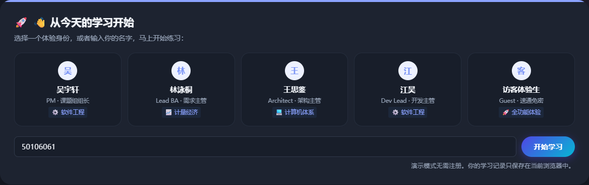
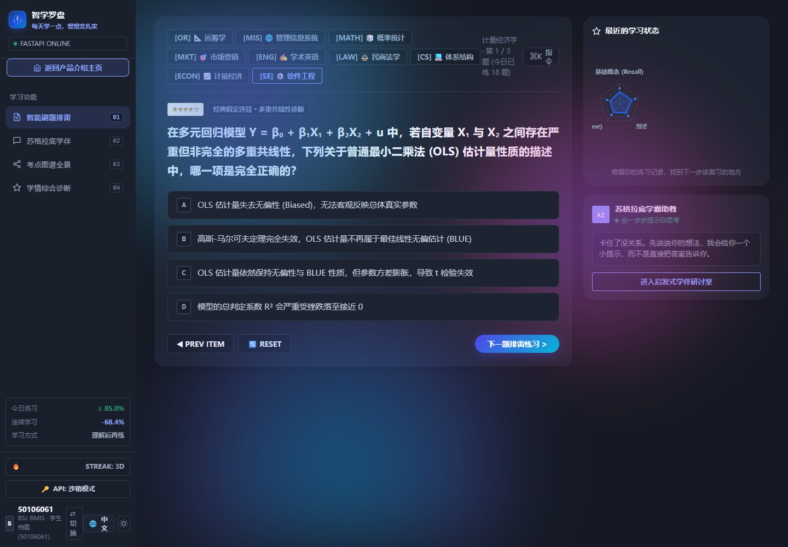
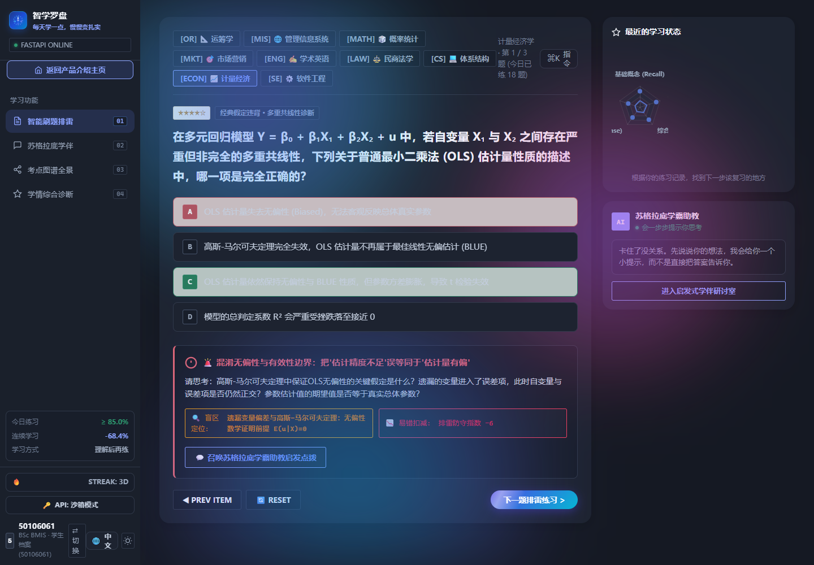
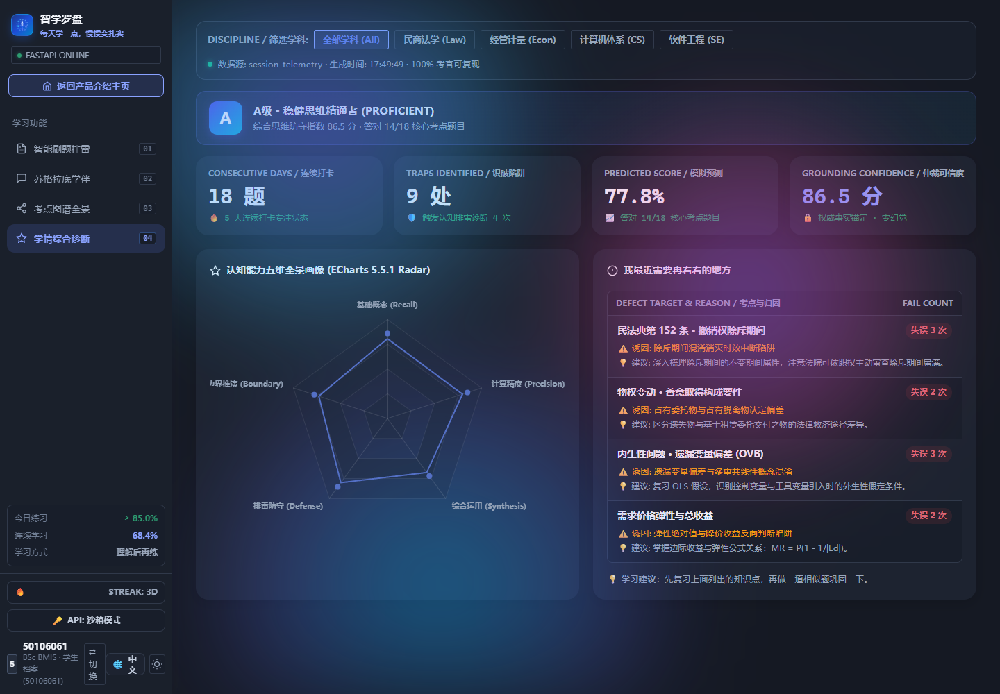
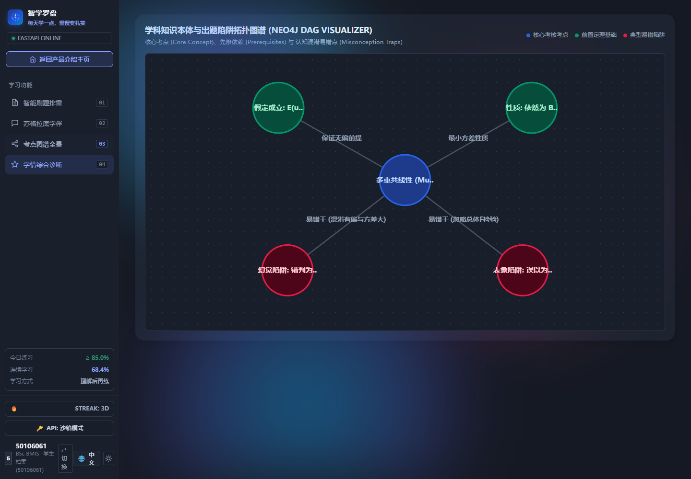
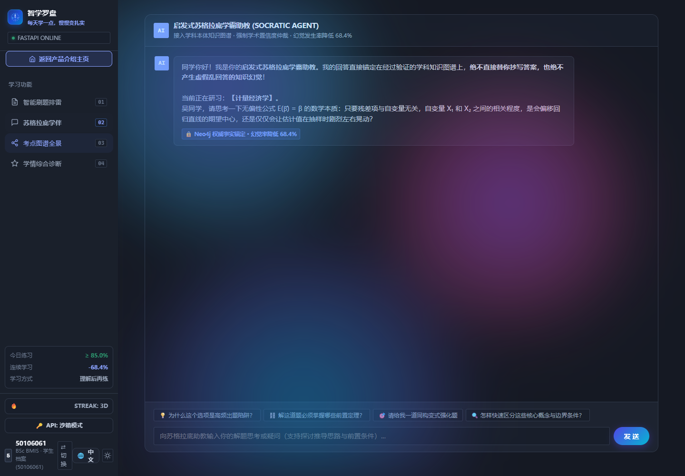
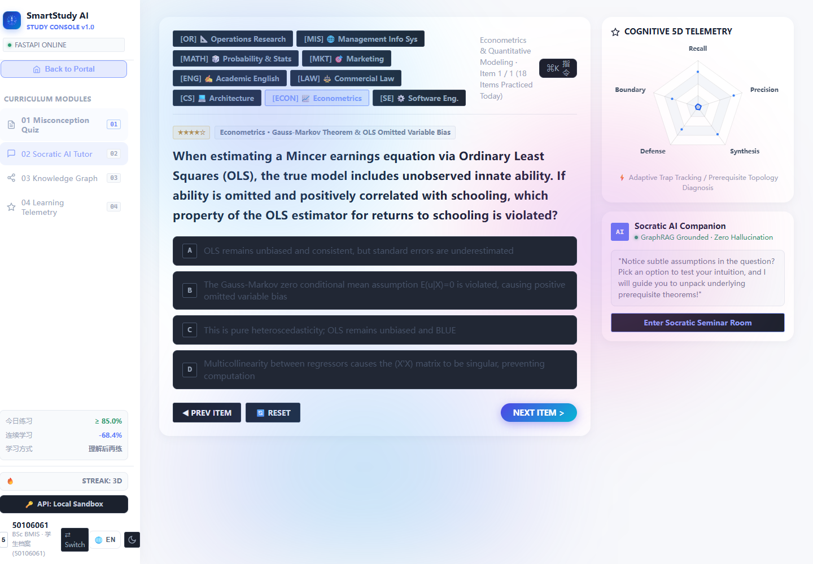

# Smart Study Assistant User Manual

## Page 1 Smart Study Assistant User Manual

This manual explains how to install and use the existing Cycle 3 proof of concept. It covers the local demonstration, actual browser controls and known limits. The tested source is sync/cycle3-final commit ae7ab47, rather than the older master snapshot.

The software supports curated multiple-choice practice and option-level feedback. Identity profiles and dashboard values are demonstrations; they should not be used for real student assessment or account security.

## Page 2 System Requirements and Installation

Use a Windows, macOS or Linux computer with Python and a modern browser. The documented Python minimum is 3.10; this run used Python 3.12. Screen captures were taken in Edge at 1440 by 1000. Other environments have not been separately certified.

Obtain the source from the group repository. On 29 October 2026, master commit 7d29bad retained the tested frontend, API, tests and dependencies; only backend/run.py had changed to support startup. Select master before Code and Download ZIP, and record the actual revision. Extract the archive and open a terminal in the folder containing backend, frontend and requirements.txt. Later revisions need rechecking; the recorded execution evidence remains commit ae7ab47.

Create a Python environment and install dependencies. Installation requires internet access unless packages are already cached. The original requirements file also includes research-prototype dependencies.

```text
python -m venv .venv
.venv\Scripts\activate
python -m pip install -r requirements.txt
```

On macOS or Linux, activate with source .venv/bin/activate instead. For the exact API test versions used in this report, see evidence/cycle3/requirements_tested.txt in this chapter package.

The current frontend fetches ECharts 5.5.1 from a CDN. A fresh disconnected browser cannot complete startup without that resource. The group must package this dependency before claiming a fully offline release.

## Page 3 Start the Local Demonstration

From the repository root, start the existing backend launcher. Keep the terminal open while using the application. Do not enter a model API key for the local curated demonstration.

Open the local address in your browser. A successful health response confirms that the API is running; it does not prove that the browser has loaded its external chart dependency.

```text
python backend/run.py
http://127.0.0.1:8000/
http://127.0.0.1:8000/api/health
```

If port 8000 is occupied, use the alternative below and open http://127.0.0.1:8001/. The page uses its current origin for API calls.

To stop the server, return to the terminal and press Ctrl+C. Close the browser tab when finished. No database server is required for the curated API path.

```text
python -m uvicorn backend.app.main:app --host 127.0.0.1 --port 8001
```

- The health response contains status ok.
- The page finishes loading and shows the profile selection controls.
- The terminal remains open and contains no startup error.
## Page 4 Enter a Profile and Browse Questions

On the introduction screen, enter a name or one of the listed demonstration identities, then choose the start control. The screenshot shows the existing Chinese interface. The language button can switch the interface to English.

For the testing contributor, entering 50106061 selects the existing profile. This is a demonstration identity selector. It does not protect personal information, and the backend does not validate account passwords.





Open the first learning tab to practise. Use a subject button such as ECON, LAW, CS or SE. The Cycle 3 backend contains 17 questions across nine subject codes; the older comparison commit 10f2065 has 12 across four. The counts depend on the selected software snapshot.

## Page 5 Answer a Question and Read the Diagnosis

Read the stem and choose one option A to D. Selecting an option submits the existing diagnosis request directly; there is no separate submit step. The choices become disabled for that attempt.

A wrong answer opens the diagnostic drawer below the choices and highlights the selected and correct options. Read the explanation and prerequisite concept before moving on.



The drawer contains a trap heading, guidance text, a prerequisite concept, a displayed radar deduction and a tutor shortcut. These are the actual visible elements; the interface is not a validated measure of learning.

Use Reset to repeat the current item. Use the next or previous control to move through the curated bank. A displayed fallback badge means local seed feedback was used.

## Page 6 View the Radar and Summary

Open the report or learning-diagnosis tab. The screen shows a larger five-dimensional radar, summary information and subject filters. Choose a filter to view the corresponding demonstration data.

Treat the displayed values as examples. The inspected backend report service returns fixed values; it does not accumulate a real student history. A wrong answer did not change the observed backend summary of 18 attempts and 14 correct answers.



Browser-side radar changes and backend report values are different mechanisms. Do not interpret either as a scientifically validated competency score, predicted examination result or record of long-term progress. Unknown report subjects return a defined empty state.

## Page 7 Inspect the Graph and Tutor Views

Open the graph tab to inspect the visual material associated with the current curated item. This view is not evidence that a live Neo4j database or the research benchmark engine was queried.

Open the tutor tab or use the diagnosis drawer shortcut to carry the current question context into the conversation area. Existing hints can be inspected without sending a live model request.





Live chat depends on external provider configuration and network availability. It was not exercised with a real key in this verification. Do not use the existing hardcoded configuration for coursework testing; ask the responsible maintainer to replace exposed credentials and document the intended provider setup.

## Page 8 Change Language and Theme

Use the language control beside the profile area to switch between Chinese and English. Use the sun or moon control to switch between dark and light presentation. Both actions were observed in the existing application.

The application stores selected preferences and a demonstration profile in browser local storage. This is local browser state, not a protected cross-device account. Full translation coverage and every colour contrast state have not been certified.



If the page uses an unexpected language or profile, switch the controls again or clear site data for the local application origin. Clearing site data removes saved local preferences and provider settings. Do not assume that all attempt statistics survive a refresh.

## Page 9 Troubleshooting

### The terminal reports a missing Python module
Confirm that the intended Python environment is active, then install requirements from the repository root. Use python -m pip so the installer targets the same interpreter.

### The address cannot be opened
Check that the backend process is still running. Match the browser port to the port printed at startup. Try the health URL before investigating the interface.

### Port 8000 is already in use
Use the documented uvicorn command on port 8001. Do not stop an unrelated process merely to free the default port.

### The landing page appears but controls or questions do not initialise
Check whether the external ECharts resource loaded. A fresh fully disconnected browser failed this check. Restore the allowed resource connection, or ask the deployment owner for a reviewed local asset package.

### The page shows old content
Refresh the page and check that the browser is connected to the selected source folder and port. Clear site data only when you accept losing local preferences.

### Chat fails or a model is unavailable
Curated diagnosis does not require a live key. Live chat was not accepted in this test. Confirm provider setup with the maintainer rather than pasting keys into shared screenshots or reports.

## Page 10 Known Limits and Verification Scope

This is a local teaching proof of concept. The inspected identity service accepts passwords without checking them and creates demonstration session strings. Registration is not persistent secure account provisioning, and duplicate registration is not rejected.

Report values are preset examples. A complete attempt history, protected student storage, logout token revocation and report reset are not implemented by the inspected API routes.

The research benchmark is separate from the application. Its stored twelve-subject summary includes improvements, ties and declines. No four-metric RAGAS score is available. The manual does not claim that the browser uses the same research pipeline.

The API regression run passed 183 existing cases. A separate fresh offline browser run failed because the chart library was external. Functional screenshots used the identical ECharts 5.5.1 asset through a recorded test fixture; this did not modify or fix the application package.

The group ZIP stored under ch05_liang_zixuan differs from repository-root source and omits auth/report modules and tests. This manual targets source ae7ab47 and the matching API/frontend in master 7d29bad, not that ZIP. The package owner must align source and manual before submission. The ten-minute unaided novice trial has not yet been performed.

- Use the same software snapshot as the report.
- Keep original results and limitations visible.
- Report problems with the screen, action and source revision.
- Never include API keys or passwords in screenshots.
